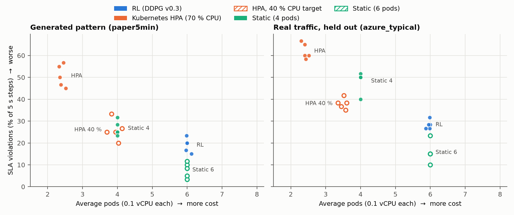

# AWS Kubernetes-tier results, model-v0.3 (2026-11-27)

Model [`model-v0.3`](https://github.com/plaethos99/drl-autoscaler/releases/tag/model-v0.3) (DDPG seed 3, Kubernetes
tier, trained on the simulator calibrated on this cluster) vs the **real Kubernetes HorizontalPodAutoscaler** vs static
allocation, on a k3s cluster on AWS, plus two **equal-cost baselines** run afterwards to check where RL's advantage
comes from. Simulator results for the same model: [`../sim-results-v0.3`](../sim-results-v0.3/README.md).

**Summary.** RL clearly beats the cluster HPA and static 4 pods, but it uses about 6 pods to do it, and a **fixed
allocation of 6 pods beats RL** at the same cost (7.7 vs 19.0 % and 15.7 vs 28.3 % SLA violations, p ≤ 0.002). On
this tier the model has learned *how many* pods the load needs on average, but moving pods up and down costs more
than it gains. A tuned HPA (40 % CPU target) needs a third fewer pods than RL and violates the SLA more.

## Setup

| | |
|---|---|
| Cluster | `drl-k8s-test`, m7i-flex.large (2 vCPU, 8 GiB), Ubuntu 24.04, ap-southeast-2; single-node k3s (CNCF-conformant Kubernetes), set up by `agent/scripts/k8s-setup.sh` |
| Load box | `drl-loadgen`, t3.small, Locust in manual mode driven by `dashboard.drive` (target sent per run) |
| Autoscaled tier | Deployment `imgsvc/classifier`, 1 unit = 1 pod with 0.1 vCPU (request = limit, Guaranteed QoS), 1–8 pods; the controller runs `kubectl scale` |
| Routing | gateway (LoadBalancer :8080, no upstream keep-alive) → Service → kube-proxy picks a random ready pod per connection |
| Metrics | the controller reads pending pods from the Deployment and CPU from each pod's cgroup; Prometheus for latency |
| HPA baseline | `autoscaling/v2` HPA on the classifier, 70 % CPU target, 1–8 pods, metrics-server (15 s resolution), controller sync every 5 s, scale-down stabilisation 30 s (`k8s/testbed/hpa.yaml`); the agent only observes during these runs |
| Equal-cost baselines | `hpa40`: the same HPA with a 40 % CPU target; `static6`: a fixed 6 pods, RL's average (`run_test.sh hpa<pct>` / `static<units>`) |
| Calibration | `MU_PER_UNIT = 3.9` req/s per pod within the SLA; pod start-up 11.7 s |
| Scenarios | `paper5min` (generated) and `azure_typical` (a held-out 5-minute window of the Azure Functions 2021 trace, days 11–14, never seen in training); 31 peak users |
| Runs | Session 1: 5 rounds × 2 scenarios × {rl, hpa, static}, 05:23–08:12 UTC, commit `8498cbe`. Session 2 (same box after a stop/start): 5 rounds × 2 scenarios × {hpa40, static6}, 09:17–11:10 UTC, commit `b28f674`. 5 min each, interleaved; start at 2 pods (static: 4 or 6) |

## Figures


*Bars: mean of 5 runs; dots: individual 5-minute runs; hatched bars are the equal-cost baselines. RL beats the
standard HPA and static 4 pods, but static 6 pods (the same average cost as RL) beats RL on every metric.*



*Each dot is one run; down-left is better; hollow markers are the equal-cost baselines. At about 6 pods, the fixed
allocation sits well below RL; at about 4 pods, the 40 % HPA and static 4 pods are close to each other.*


*The released model and the original baselines in the calibrated simulator and on AWS. The ranking (RL < static 4 <
HPA) is the same everywhere; the simulator matches the HPA on `paper5min` but is too optimistic for RL. On real
traffic the simulator averages 10 random held-out windows, AWS plays one of them (`azure_typical`, a busier one).*

## Results (mean ± SD over 5 runs)

### `paper5min` (generated pattern)

| Method | SLA violations % | Mean p95 ms | Worst p95 ms | Avg pods | Cost (pod-steps) | Scaling actions |
|---|---|---|---|---|---|---|
| RL (DDPG v0.3) | 19.0 ± 3.2 | 351 ± 16 | 1273 ± 107 | 6.01 ± 0.06 | 360.6 ± 3.7 | 17.0 ± 3.7 |
| Kubernetes HPA (70 %) | 50.7 ± 5.1 | 947 ± 60 | 3558 ± 760 | 2.41 ± 0.08 | 144.4 ± 4.6 | 6.0 ± 0.7 |
| HPA, 40 % target | 26.0 ± 4.8 | 438 ± 44 | 2058 ± 479 | 3.93 ± 0.17 | 235.8 ± 10.2 | 7.2 ± 0.8 |
| Static (4 pods) | 26.7 ± 3.3 | 491 ± 27 | 1837 ± 327 | 4.00 | 240.0 | 0 |
| **Static (6 pods)** | **7.7 ± 3.5** | **208 ± 11** | **663 ± 77** | 6.00 | 360.0 | 0 |

### `azure_typical` (real traffic, held out)

| Method | SLA violations % | Mean p95 ms | Worst p95 ms | Avg pods | Cost (pod-steps) | Scaling actions |
|---|---|---|---|---|---|---|
| RL (DDPG v0.3) | 28.3 ± 2.0 | 409 ± 19 | 1535 ± 187 | 5.96 ± 0.05 | 357.4 ± 3.2 | 15.4 ± 4.9 |
| Kubernetes HPA (70 %) | 62.0 ± 3.6 | 1063 ± 169 | 3745 ± 1088 | 2.41 ± 0.08 | 144.6 ± 4.7 | 5.0 ± 1.4 |
| HPA, 40 % target | 38.0 ± 2.5 | 692 ± 114 | 4153 ± 1218 | 3.50 ± 0.10 | 209.8 ± 6.0 | 7.4 ± 0.5 |
| Static (4 pods) | 48.3 ± 4.7 | 549 ± 44 | 1506 ± 194 | 4.00 | 240.0 | 0 |
| **Static (6 pods)** | **15.7 ± 4.8** | **293 ± 22** | **866 ± 179** | 6.00 | 360.0 | 0 |

### Significance (two-sided; Welch t-test / exact Mann-Whitney U, n = 5 vs 5; "RL −x %" = RL lower)

| RL vs … | Metric | `paper5min` | `azure_typical` |
|---|---|---|---|
| HPA (70 %) | SLA violations | p < 0.001 / 0.008 (RL −63 %) | p < 0.001 / 0.008 (RL −54 %) |
| | Mean p95 | p < 0.001 / 0.008 (RL −63 %) | p < 0.001 / 0.008 (RL −62 %) |
| | Pods | p < 0.001 / 0.008 (RL +150 %) | p < 0.001 / 0.008 (RL +147 %) |
| HPA, 40 % target | SLA violations | p = 0.030 / 0.032 (RL −27 %) | p < 0.001 / 0.008 (RL −25 %) |
| | Mean p95 | p = 0.009 / 0.016 (RL −20 %) | p = 0.005 / 0.008 (RL −41 %) |
| | Pods | p < 0.001 / 0.008 (RL +53 %) | p < 0.001 / 0.008 (RL +70 %) |
| Static (4 pods) | SLA violations | p = 0.006 / 0.016 (RL −29 %) | p < 0.001 / 0.008 (RL −41 %) |
| | Mean p95 | p < 0.001 / 0.008 (RL −28 %) | p < 0.001 / 0.008 (RL −26 %) |
| | Pods | p < 0.001 / 0.008 (RL +50 %) | p < 0.001 / 0.008 (RL +49 %) |
| **Static (6 pods)** | SLA violations | p < 0.001 / 0.008 (**RL +148 %**) | p = 0.002 / 0.008 (**RL +81 %**) |
| | Mean p95 | p < 0.001 / 0.008 (RL +69 %) | p < 0.001 / 0.008 (RL +39 %) |
| | Worst p95 | p < 0.001 / 0.008 (RL +92 %) | p < 0.001 / 0.008 (RL +77 %) |
| | Pods | p = 0.74 / 0.17 (same) | p = 0.13 / 0.048 (RL −1 %) |

0.008 is the smallest p-value an exact Mann-Whitney test can give with 5 vs 5 runs (every run of one method better
than every run of the other).

## Where RL loses its violations (step-level data, RL runs of session 1)

From `decisions.sqlite` on the cluster box (600 RL steps, 5 s each):

| RL steps | Steps | SLA violations | Mean load |
|---|---|---|---|
| no change of the requested pods in the previous 15 s | 284 | 55 (19 %) | 11.3 req/s |
| within 15 s of a scale-up or scale-down | 306 | 86 (28 %) | 10.0 req/s |
| *Static 6 pods, all steps (session 2)* | *600* | *70 (12 %)* | |

RL changes the pod count in about half of all 15 s windows. The steps right after a change violate the SLA more
often than the others, although their load is lower. Likely reasons (not measured separately): a new pod needs
~12 s to become ready while the load is already high, and a pod being removed stops taking new connections, so for
some seconds the remaining pods carry more than their share. Even outside these windows RL is worse than static 6
pods: its average of 6 is made of periods with 4–5 ready pods and periods with 7–8.

## Reading

* **RL beats the default Kubernetes HPA clearly** (−54 to −63 % violations, −62 % mean p95; every RL run better than
  every HPA run). The default HPA under-provisions on this testbed: each pod is capped at its 0.1-vCPU request, so
  measured utilisation can never exceed 100 % and each decision can at most grow the Deployment to `ceil(pods / 0.7)`
  (2 → 3, 3 → 5); it sees CPU through a 15 s window and new pods need ~12 s. It settles at 2.4 pods. The simulator's
  HPA model reproduces this (48–54 % simulated vs 51 % measured on `paper5min`).
* **A tuned HPA (40 % target) closes much of the gap at lower cost:** 26 / 38 % violations with 3.5–3.9 pods vs
  RL's 19 / 28 % with 6. RL is still significantly better on SLA, at 53–70 % more pods.
* **At equal cost, a fixed allocation beats RL.** Static 6 pods has 59 % (`paper5min`) and 45 % (`azure_typical`)
  fewer violations than RL, with the same average pods. So the RL policy's gain over the HPA comes from provisioning
  more pods, not from scaling better. Scaling actions themselves are costly on this tier (slow pod start-up, random
  routing over a changing pod set), and the simulator does not charge enough for them.
* **This is a simulator-to-reality gap, not a tuning detail.** In the simulator RL was at 5–6 % violations and
  static 4 pods at 11–21 %; on AWS every method is worse, and frequent scaling hurts more than the simulator
  predicts. On the VM tier (`../aws-results-v0.2`) a resize takes effect at once (`docker update --cpus`), so the
  effect may be smaller there, but RL was not compared with an equal-cost static allocation on that tier either
  (static 4 units vs RL's 6.4); that check is still open.
* **Real traffic is harder for every method** (+8 to +22 points of violations).

## What this means for the next model

* Charge each scaling action more in the reward, or give the k8s profile a slower and noisier start-up and a
  latency penalty right after a change, so the policy learns to change less often.
* Add a hold-time / hysteresis option to the controller (as the HPA's stabilisation window does).
* Report static allocation at the RL policy's average size as a standard baseline for every tier.

## Limitations

* The equal-cost baselines ran in a second session (same box, after a stop/start, about one hour later). Static 4
  pods and the HPA were stable between the calibration round and session 1 (HPA 50 % vs 50.7 % on `paper5min`),
  so a session effect of this size is unlikely, but RL was not re-run in session 2.
* One single-node cluster on a 2-vCPU box. A multi-node cluster (e.g. kubeadm with dedicated worker nodes) would
  remove contention between the workload and the control plane.
* 5 runs per cell, one load window per scenario.

## Reproduce

```
python docs/aws-results-v0.2/analyze.py docs/aws-results-k8s-v0.3/summary.csv
python docs/aws-results-k8s-v0.3/make_figures.py      # needs matplotlib
```

`summary.csv` is the per-run table from `python -m autoscaler report` on the cluster box. The `policy` column is the
controller's policy (`hpa`, `static`); the variant (`hpa40`, `static6`) is the second field of `run_id`, which is
what `analyze.py` and `make_figures.py` group by. `analyze.py` (shared with the VM results) computes the tables
above in pure Python; `make_figures.py` draws `figures/` from it and the simulator's per-episode results
(`../sim-results-v0.3/sim_eval_results.csv`). The step-level data is in `~/results/decisions.sqlite` on
`drl-k8s-test`. How to set up the cluster and run the test:
[`../DEPLOY.md`](../DEPLOY.md#kubernetes-tier-a-third-instance-with-k3s).
