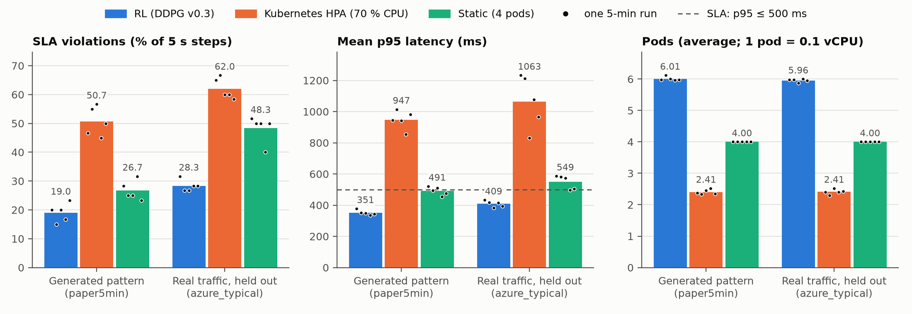
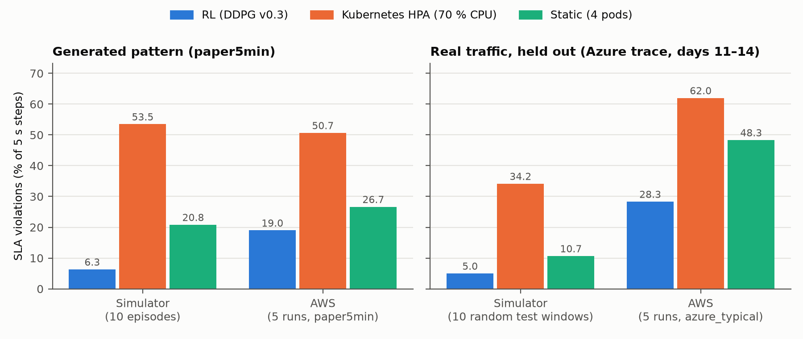

# AWS Kubernetes-tier results, model-v0.3 (2026-11-27)

Model [`model-v0.3`](https://github.com/plaethos99/drl-autoscaler/releases/tag/model-v0.3) (DDPG seed 3, Kubernetes
tier, trained on the simulator calibrated on this cluster) vs the **real Kubernetes HorizontalPodAutoscaler** vs static
allocation, on a k3s cluster on AWS. Simulator results for the same model: [`../sim-results-v0.3`](../sim-results-v0.3/README.md).

## Setup

| | |
|---|---|
| Cluster | `drl-k8s-test`, m7i-flex.large (2 vCPU, 8 GiB), Ubuntu 24.04, ap-southeast-2; single-node k3s (CNCF-conformant Kubernetes), set up by `agent/scripts/k8s-setup.sh` |
| Load box | `drl-loadgen`, t3.small, Locust in manual mode driven by `dashboard.drive` (target sent per run) |
| Autoscaled tier | Deployment `imgsvc/classifier`, 1 unit = 1 pod with 0.1 vCPU (request = limit, Guaranteed QoS), 1–8 pods; the controller runs `kubectl scale` |
| Routing | gateway (LoadBalancer :8080, no upstream keep-alive) → Service → kube-proxy picks a random ready pod per connection |
| Metrics | the controller reads pending pods from the Deployment and CPU from each pod's cgroup; Prometheus for latency |
| HPA baseline | `autoscaling/v2` HPA on the classifier, 70 % CPU target, 1–8 pods, metrics-server (15 s resolution), controller sync every 5 s, scale-down stabilisation 30 s (`k8s/testbed/hpa.yaml`); the agent only observes during these runs |
| Calibration | `MU_PER_UNIT = 3.9` req/s per pod within the SLA; pod start-up 11.7 s |
| Scenarios | `paper5min` (generated) and `azure_typical` (a held-out 5-minute window of the Azure Functions 2021 trace, days 11–14, never seen in training); 31 peak users |
| Runs | 5 rounds × 2 scenarios × {rl, hpa, static}, 5 min each, interleaved; start at 2 pods (static: 4) |
| Code | `run_all.sh` with `TIER=k8s POLICIES="rl hpa static"` at commit `8498cbe`, 05:23–08:12 UTC |

## Figures



*Bars: mean of 5 runs; dots: individual 5-minute runs. RL has the fewest SLA violations and the lowest p95 on both
scenarios and is the only method with a mean p95 under 500 ms on both; it keeps about 6 pods where the HPA keeps 2.4.*


*Each dot is one run; down-left is better. The three methods sit at three clearly separated cost levels.*



*The released model and the baselines in the calibrated simulator and on AWS. The ranking (RL < static < HPA) is
the same everywhere; the simulator matches the HPA on `paper5min` but is too optimistic for RL. On real traffic the
simulator averages 10 random held-out windows, AWS plays one of them (`azure_typical`, a busier one).*

## Results (mean ± SD over 5 runs)

### `paper5min` (generated pattern)

| Method | SLA violations % | Mean p95 ms | Worst p95 ms | Avg pods | Cost (pod-steps) | Scaling actions |
|---|---|---|---|---|---|---|
| **RL (DDPG v0.3)** | **19.0 ± 3.2** | **351 ± 16** | **1273 ± 107** | 6.01 ± 0.06 | 360.6 ± 3.7 | 17.0 ± 3.7 |
| Kubernetes HPA | 50.7 ± 5.1 | 947 ± 60 | 3558 ± 760 | 2.41 ± 0.08 | 144.4 ± 4.6 | 6.0 ± 0.7 |
| Static (4 pods) | 26.7 ± 3.3 | 491 ± 27 | 1837 ± 327 | 4.00 | 240.0 | 0 |

### `azure_typical` (real traffic, held out)

| Method | SLA violations % | Mean p95 ms | Worst p95 ms | Avg pods | Cost (pod-steps) | Scaling actions |
|---|---|---|---|---|---|---|
| **RL (DDPG v0.3)** | **28.3 ± 2.0** | **409 ± 19** | 1535 ± 187 | 5.96 ± 0.05 | 357.4 ± 3.2 | 15.4 ± 4.9 |
| Kubernetes HPA | 62.0 ± 3.6 | 1063 ± 169 | 3745 ± 1088 | 2.41 ± 0.08 | 144.6 ± 4.7 | 5.0 ± 1.4 |
| Static (4 pods) | 48.3 ± 4.7 | 549 ± 44 | **1506 ± 194** | 4.00 | 240.0 | 0 |

### Significance (two-sided; Welch t-test / exact Mann-Whitney U, n = 5 vs 5)

| Metric | RL vs HPA, `paper5min` | RL vs HPA, `azure_typical` | RL vs static, `paper5min` | RL vs static, `azure_typical` |
|---|---|---|---|---|
| SLA violations | p < 0.001 / 0.008 (RL −63 %) | p < 0.001 / 0.008 (RL −54 %) | p = 0.006 / 0.016 (RL −29 %) | p < 0.001 / 0.008 (RL −41 %) |
| Mean p95 | p < 0.001 / 0.008 (RL −63 %) | p < 0.001 / 0.008 (RL −62 %) | p < 0.001 / 0.008 (RL −28 %) | p < 0.001 / 0.008 (RL −26 %) |
| Worst p95 | p = 0.002 / 0.008 (RL −64 %) | p = 0.010 / 0.008 (RL −59 %) | p = 0.015 / 0.016 (RL −31 %) | p = 0.82 / 0.73 (RL +2 %, n.s.) |
| Pods (cost) | p < 0.001 / 0.008 (RL **+150 %**) | p < 0.001 / 0.008 (RL **+147 %**) | p < 0.001 / 0.008 (RL +50 %) | p < 0.001 / 0.008 (RL +49 %) |

0.008 is the smallest p-value an exact Mann-Whitney test can give with 5 vs 5 runs (all RL runs better than all
baseline runs).

## Reading

* **RL beats the real Kubernetes HPA clearly** on SLA violations (−54 to −63 %), mean p95 (−62 %) and worst p95
  (−59 to −64 %), on the generated scenario and on held-out real traffic; every RL run is better than every HPA run.
* **Why the HPA does badly here:** each pod is capped at its 0.1-vCPU request, so measured utilisation can never
  exceed 100 % and each HPA decision can at most grow the Deployment to `ceil(pods / 0.7)` (2 → 3, 3 → 5); it sees CPU only through a 15 s
  metrics-server window and new pods need ~12 s to become ready. It settles at about 2.4 pods, under the ~4 pods the
  load needs. This is the CPU-target HPA configured the usual way (70 %), not a tuned one; the agent's
  under-provisioning baseline in the simulator (`hpa_util_cap`, `hpa_metric_steps`) reproduces it (48–54 % simulated
  vs 51 % measured on `paper5min`).
* **The price is pods:** RL keeps about 6 pods, 2.5 × the HPA and 1.5 × static. Most of its gain over the HPA comes
  from provisioning enough capacity; against static allocation, the extra 2 pods buy 29–41 % fewer violations.
* **RL still violates the SLA in 19–28 % of steps** at 6 pods, much more than the 5–6 % the simulator predicted. With
  random routing to 0.1-vCPU pods, bursts that land on one pod queue behind each other, and all pods share one
  2-vCPU node with the gateway, resizer and control plane; the simulator's latency model has a 36 % median error on
  this tier and underestimates these tails.
* **Real traffic is harder for every method** (+9 to +22 points of violations); RL's ranking holds.
* RL changes the allocation 15–17 times per 5 minutes, the HPA 5–6 times.

## Limitations

* **No equal-cost baseline.** RL's advantage over static 4 pods could partly be the extra capacity. A static
  allocation of 6 pods, or an HPA with a lower CPU target (e.g. 40 %), would separate "adapts better" from "uses
  more pods". These were not run on AWS.
* One single-node cluster on a 2-vCPU box. A multi-node cluster (e.g. kubeadm with dedicated worker nodes) would
  remove contention between the workload and the control plane.
* 5 runs per cell, one load pattern window per scenario.

## Reproduce

```
python docs/aws-results-v0.2/analyze.py docs/aws-results-k8s-v0.3/summary.csv
python docs/aws-results-k8s-v0.3/make_figures.py      # needs matplotlib
```

`summary.csv` is the per-run table from `python -m autoscaler report` on the cluster box; `analyze.py` (shared with
the VM results) computes the tables above in pure Python; `make_figures.py` draws `figures/` from it and the
simulator's per-episode results (`../sim-results-v0.3/sim_eval_results.csv`). The step-level data is in
`~/results/decisions.sqlite` on `drl-k8s-test`. How to set up the cluster and run the test:
[`../DEPLOY.md`](../DEPLOY.md#kubernetes-tier-a-third-instance-with-k3s).
